# 패치노트 피드 22개 (사진 1장 + 캡션)

> 이 파일은 `_src/patch.mjs`가 만든다. 문구를 고치려면 그 파일을 고치고 `npm run build:patch`를 다시 실행한다(이미지와 캡션이 같이 바뀐다).
> 이미지 1080×1350(4:5) · QR은 `utm_campaign=patch`
> 파일 이름과 제목 앞의 날짜가 인스타그램 예약 게시일이다(`post` 값). 날짜를 바꾸면 `patch.mjs`의 그 피드에서 `post`를 고치고 다시 만든다(파일 이름도 같이 바뀌니 옛 PNG는 지운다).

## 예약 현황

| 게시일 | 피드 | 메모 |
|---|---|---|
| 2026-11-13 | mobile | 18:00 첫 게시물 |
| 2026-11-14 | share-card |  |
| 2026-11-15 | customize |  |
| 2026-11-16 | titles |  |
| 2026-11-17 | death |  |
| 2026-11-18 | new-keyword |  |
| 2026-11-19 | score |  |
| 2026-11-20 | 24h |  |
| 2026-11-21 | stealth |  |
| 2026-11-22 | hook |  |
| 2026-11-23 | cleanse |  |
| 2026-11-24 | darkness |  |
| 2026-11-25 | poison |  |
| 2026-11-26 | loadout |  |
| 2026-11-27 | dash |  |
| 2026-11-28 | orbs |  |
| 2026-11-29 | flame |  |
| 2026-11-30 | heal |  |
| 2026-12-01 | hp |  |
| 2026-12-02 | boss | 보스 보상과 한 게시물로 |
| 2026-12-02 | boss-reward | 보스와 한 게시물로 |
| 2026-12-03 | wheel | 마지막 게시물 |

---

## 2026-11-13 · mobile (18:00 첫 게시물)

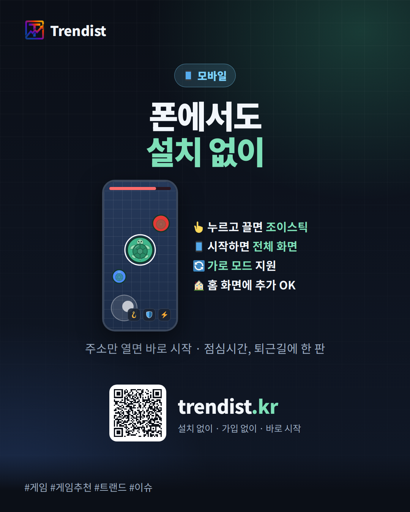

**캡션(복사해서 사용)**
```
폰에서도 설치 없이 📱

주소만 열면 바로 시작. 시작하면 전체 화면이 되고 화면을 누르고 끌면 조이스틱으로 움직여요.
가로 모드도 지원해요. 스킬·대시 버튼은 오른쪽 아래, 체력은 스킬 줄 바로 아래.
홈 화면에 추가하면 앱처럼 주소창 없이 열려요.

점심시간, 퇴근길에 한 판.

👉 프로필 링크 또는 QR로 바로 시작 (설치 없이 · 가입 없이)

(이모지 그래픽: Twemoji, CC-BY 4.0)
#게임 #게임추천 #트랜드 #이슈 #트렌디스트 #모바일 #웹게임 #설치없이 #심심할때
#game #trend #issue #trendist
```

---

## 2026-11-14 · share-card

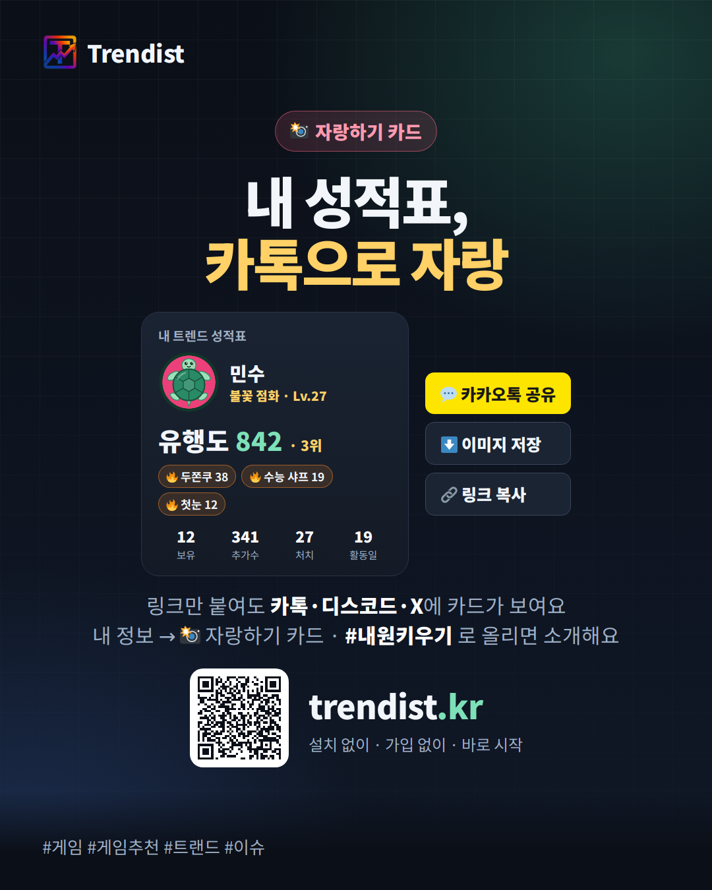

**캡션(복사해서 사용)**
```
내 성적표, 카톡으로 자랑 📸

내 정보 → [📸 자랑하기 카드]를 누르면 내 원·레벨·칭호·유행도·7일 그래프·🔥 키워드 TOP 3·기록이 담긴 카드가 만들어져요.
[💬 카카오톡 공유]를 누르면 바로 카톡으로, [⬇️ 이미지 저장]으로 인스타에.
링크를 붙여 넣기만 해도 카톡·디스코드·X에서 카드가 보여요.

"내 카드를 지금까지 N명이 봤고 M명이 게임에 들어왔어요"도 세 줘요.
#내원키우기 로 올려 주시면 계정에서 소개해 드릴게요.

👉 프로필 링크 또는 QR로 바로 시작 (설치 없이 · 가입 없이)

(이모지 그래픽: Twemoji, CC-BY 4.0)
#게임 #게임추천 #트랜드 #이슈 #트렌디스트 #자랑하기 #공유 #내원키우기 #카카오톡
#game #trend #issue #trendist
```

---

## 2026-11-15 · customize

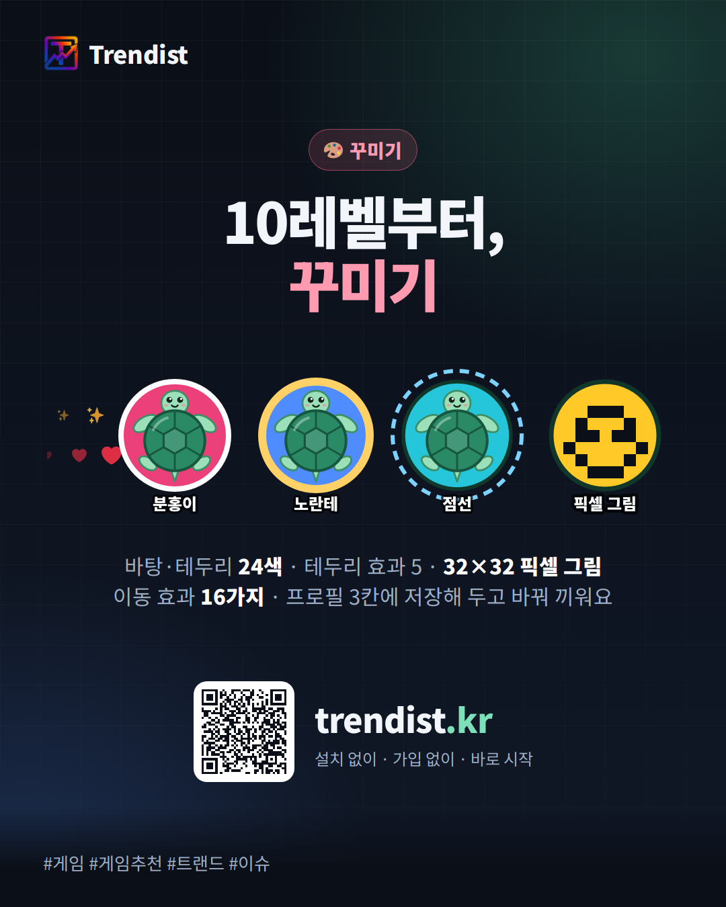

**캡션(복사해서 사용)**
```
10레벨부터, 꾸미기 🎨

바탕색·테두리 24색 + 직접 고르기, 테두리 효과 5가지(빛·점선·그라데이션·맥박·무지개), 이름표 모양.
원 안에는 거북이 대신 32×32 픽셀 그림을 직접 그려 넣을 수 있어요(왼쪽이 앞, 가는 방향을 바라봐요).
움직일 때 남는 이동 효과는 16가지 — 불꽃·무지개·별가루·하트·눈송이·발자국(거북이·고양이·새·곰·토끼)…

프로필 3칸에 저장해 두고 바꿔 끼워요.

👉 프로필 링크 또는 QR로 바로 시작 (설치 없이 · 가입 없이)

(이모지 그래픽: Twemoji, CC-BY 4.0)
#게임 #게임추천 #트랜드 #이슈 #트렌디스트 #꾸미기 #픽셀아트 #커스터마이징 #내원키우기
#game #trend #issue #trendist
```

---

## 2026-11-16 · titles

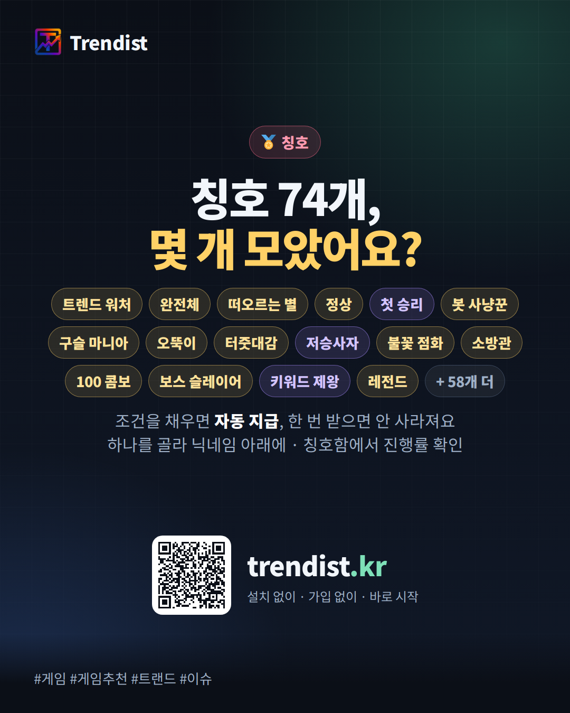

**캡션(복사해서 사용)**
```
칭호 74개, 몇 개 모았어요? 🏅

추가수·레벨·보유 키워드·유행도·순위·댓글·검색·빼앗기·봇·구슬·잃기·처치·패배·콤보·불꽃 끄기·보스… 조건을 채우면 자동으로 받아요.
한 번 받은 칭호는 안 사라지고, 하나를 골라 닉네임 아래에 달 수 있어요.
칭호함에서 아직 못 받은 칭호의 조건과 진행률도 보여요.

지금 단 칭호, 댓글로 자랑해 주세요 👇

👉 프로필 링크 또는 QR로 바로 시작 (설치 없이 · 가입 없이)

(이모지 그래픽: Twemoji, CC-BY 4.0)
#게임 #게임추천 #트랜드 #이슈 #트렌디스트 #칭호 #수집 #업적
#game #trend #issue #trendist
```

---

## 2026-11-17 · death

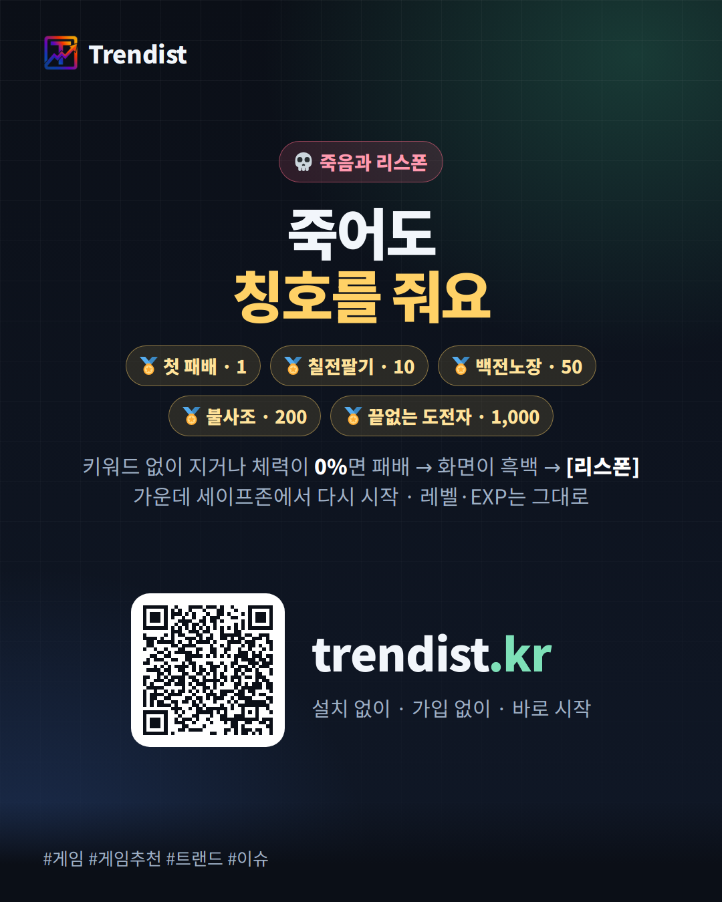

**캡션(복사해서 사용)**
```
죽어도 칭호를 줘요 💀

키워드가 하나도 없는 채로 지거나 체력이 0%가 되면 패배예요.
화면이 흑백이 되고 [리스폰]을 누르면 가운데 세이프존에서 다시 시작. 레벨·EXP는 그대로예요.

그리고 패배 횟수로 칭호가 열려요.
첫 패배 → 칠전팔기(10) → 백전노장(50) → 불사조(200) → 끝없는 도전자(1,000)
지는 걸 놀리지 않고 다시 일어서는 걸 칭찬하는 이름이에요.

👉 프로필 링크 또는 QR로 바로 시작 (설치 없이 · 가입 없이)

(이모지 그래픽: Twemoji, CC-BY 4.0)
#게임 #게임추천 #트랜드 #이슈 #트렌디스트 #칭호 #리스폰 #불사조 #칠전팔기
#game #trend #issue #trendist
```

---

## 2026-11-18 · new-keyword

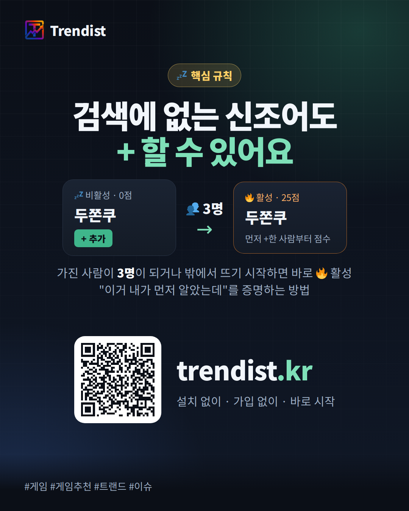

**캡션(복사해서 사용)**
```
검색에 없는 신조어도 + 할 수 있어요 💤→🔥

아직 아무도 모르는 밈이나 신조어를 검색하면 💤 카드가 떠요. 그래도 +할 수 있어요.
그 키워드를 가진 사람이 3명이 되거나 외부에서 뜨기 시작하면 그 순간 🔥 활성이 되고, 먼저 +한 사람부터 점수를 받아요.

"이거 내가 제일 먼저 알았는데"를 증명하는 방법이에요.

👉 프로필 링크 또는 QR로 바로 시작 (설치 없이 · 가입 없이)

(이모지 그래픽: Twemoji, CC-BY 4.0)
#게임 #게임추천 #트랜드 #이슈 #트렌디스트 #신조어 #밈 #먼저알았다 #트렌드
#game #trend #issue #trendist
```

---

## 2026-11-19 · score

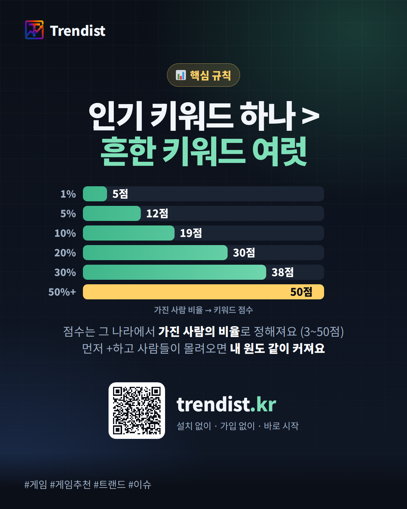

**캡션(복사해서 사용)**
```
인기 키워드 하나 > 흔한 키워드 여럿 📊

키워드 점수는 그 나라에서 "가진 사람의 비율"로 정해져요(3~50점).
1%가 가진 키워드는 5점, 10%면 19점, 50% 이상이면 50점.
그래서 남들이 아직 모르는 걸 먼저 +하고, 사람들이 몰려오면 내 원도 같이 커져요.

50%를 넘으면 더 안 올라요. 모두가 같은 키워드로 몰려가는 건 소용없어요.

👉 프로필 링크 또는 QR로 바로 시작 (설치 없이 · 가입 없이)

(이모지 그래픽: Twemoji, CC-BY 4.0)
#게임 #게임추천 #트랜드 #이슈 #트렌디스트 #규칙 #점수 #유행도 #전략
#game #trend #issue #trendist
```

---

## 2026-11-20 · 24h

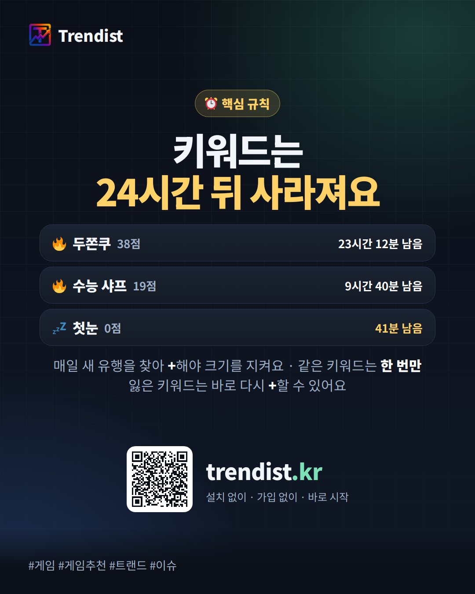

**캡션(복사해서 사용)**
```
키워드는 24시간 뒤 사라져요 ⏰

+한 키워드는 하루가 지나면 보관함에서 자동으로 빠지고, 그만큼 원이 작아져요.
그래서 매일 새 유행을 찾아야 크기를 지켜요. 같은 키워드는 한 번만 +할 수 있어요.

부딪혀서 잃은 키워드는 바로 다시 +할 수 있어요(24시간도 새로 시작).
보관함은 남은 시간순으로 정렬돼서 곧 사라질 키워드가 아래에 보여요.

👉 프로필 링크 또는 QR로 바로 시작 (설치 없이 · 가입 없이)

(이모지 그래픽: Twemoji, CC-BY 4.0)
#게임 #게임추천 #트랜드 #이슈 #트렌디스트 #규칙 #24시간 #데일리
#game #trend #issue #trendist
```

---

## 2026-11-21 · stealth

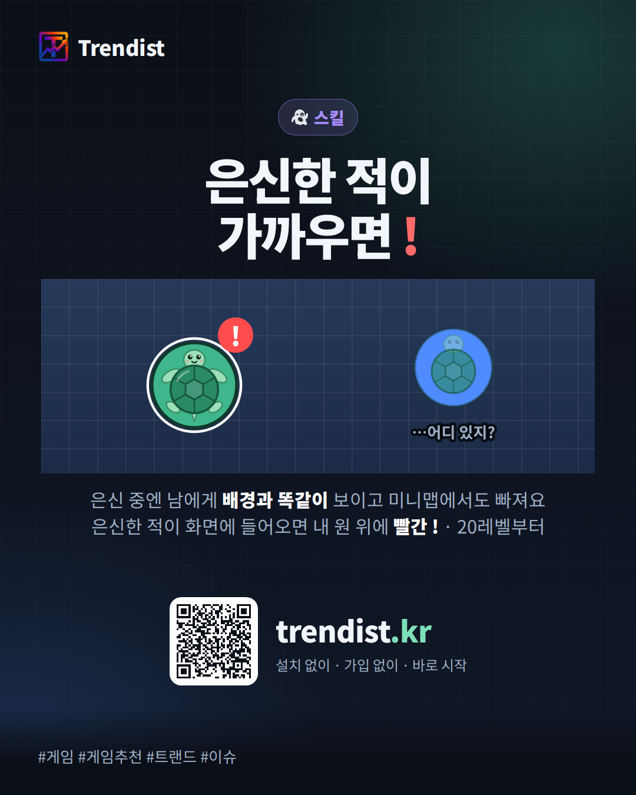

**캡션(복사해서 사용)**
```
은신 중인 적이 가까우면 ! 👻

은신하면 5초 동안 남에게는 배경과 똑같아져서 안 보여요. 이름표도 미니맵도 사라져요.
대신 은신한 적이 내 화면 안에 들어오면 내 원 위에 빨간 !가 떠요. 어디 있는지는 안 알려 줘요.

!가 뜨면 멈추지 말고 움직이세요. 20레벨부터.

👉 프로필 링크 또는 QR로 바로 시작 (설치 없이 · 가입 없이)

(이모지 그래픽: Twemoji, CC-BY 4.0)
#게임 #게임추천 #트랜드 #이슈 #트렌디스트 #스킬 #은신 #긴장감
#game #trend #issue #trendist
```

---

## 2026-11-22 · hook

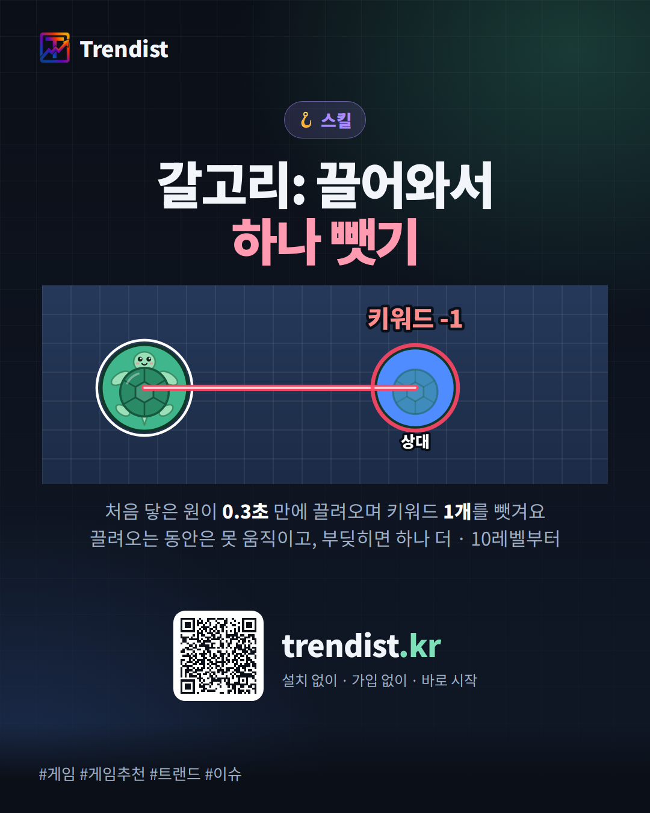

**캡션(복사해서 사용)**
```
갈고리: 끌어와서 하나 뺏기 🪝

겨눈 방향으로 갈고리를 던져요. 처음 닿은 원이 0.3초 만에 내 앞으로 끌려오고 키워드 1개를 뺏겨요.
끌려오는 동안은 움직이지도 스킬을 쓰지도 못해요. 끌려와서 부딪히면 유행도가 낮은 쪽이 하나 더 잃어요.

도망가는 상대를 잡을 때 최고. 10레벨부터.

👉 프로필 링크 또는 QR로 바로 시작 (설치 없이 · 가입 없이)

(이모지 그래픽: Twemoji, CC-BY 4.0)
#게임 #게임추천 #트랜드 #이슈 #트렌디스트 #스킬 #갈고리 #pvp
#game #trend #issue #trendist
```

---

## 2026-11-23 · cleanse

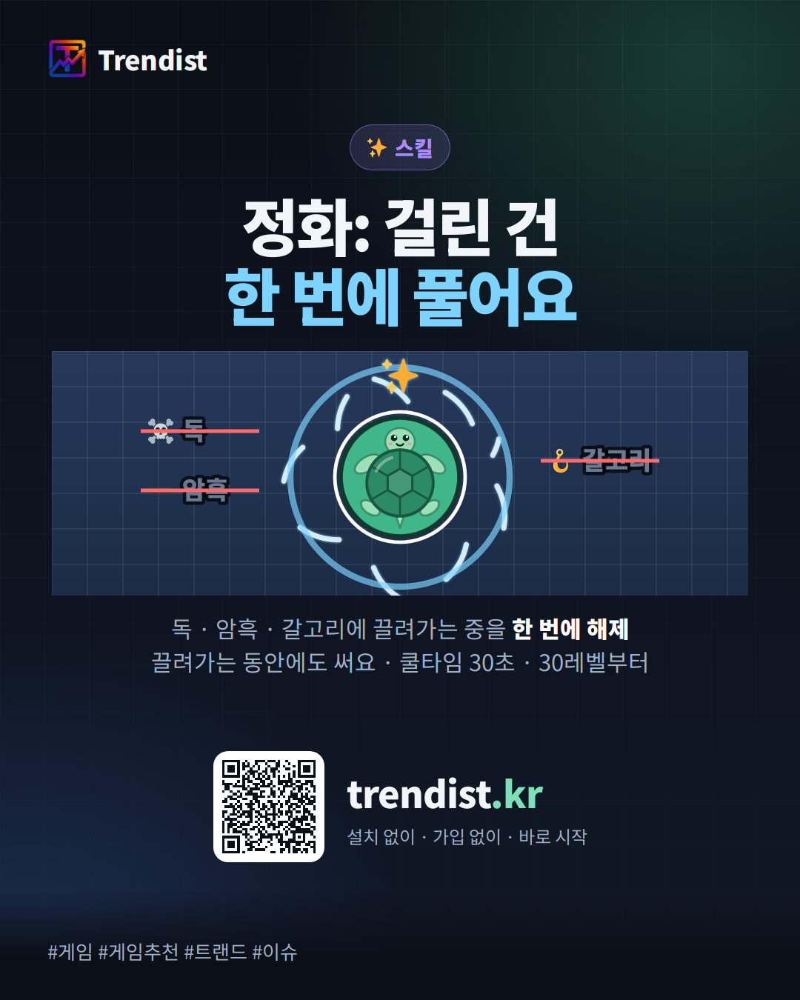

**캡션(복사해서 사용)**
```
정화: 걸린 건 한 번에 풀어요 ✨

독, 암흑, 갈고리에 끌려가는 중… 전부 한 번에 해제.
끌려가는 동안에도 쓸 수 있어서 갈고리 콤보를 끊어 버릴 수 있어요.
하늘색 테두리가 금이 가며 조각조각 튀는 연출은 모두에게 보여요.

쿨타임 30초, 30레벨부터.

👉 프로필 링크 또는 QR로 바로 시작 (설치 없이 · 가입 없이)

(이모지 그래픽: Twemoji, CC-BY 4.0)
#게임 #게임추천 #트랜드 #이슈 #트렌디스트 #스킬 #정화 #생존
#game #trend #issue #trendist
```

---

## 2026-11-24 · darkness

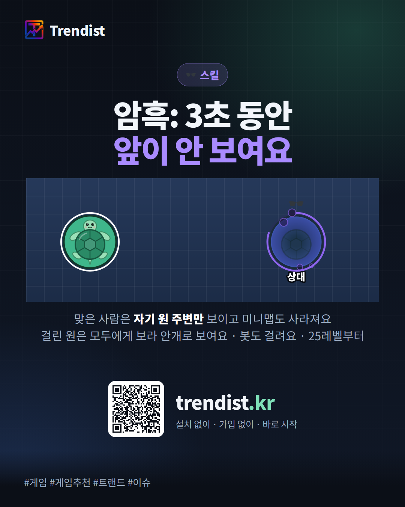

**캡션(복사해서 사용)**
```
암흑: 3초 동안 앞이 안 보여요 🕶️

검은 투사체를 던져요. 맞은 사람은 3초 동안 자기 원 주변만 보이고 나머지는 검은 연기로 덮여요. 미니맵도 사라져요.
걸린 원은 모두에게 보라색 안개와 🕶️ 표시가 보여서, 그 틈에 몰아가기 좋아요.

봇도 맞으면 똑같이 시야가 좁아져요. 25레벨부터.

👉 프로필 링크 또는 QR로 바로 시작 (설치 없이 · 가입 없이)

(이모지 그래픽: Twemoji, CC-BY 4.0)
#게임 #게임추천 #트랜드 #이슈 #트렌디스트 #스킬 #암흑 #시야
#game #trend #issue #trendist
```

---

## 2026-11-25 · poison

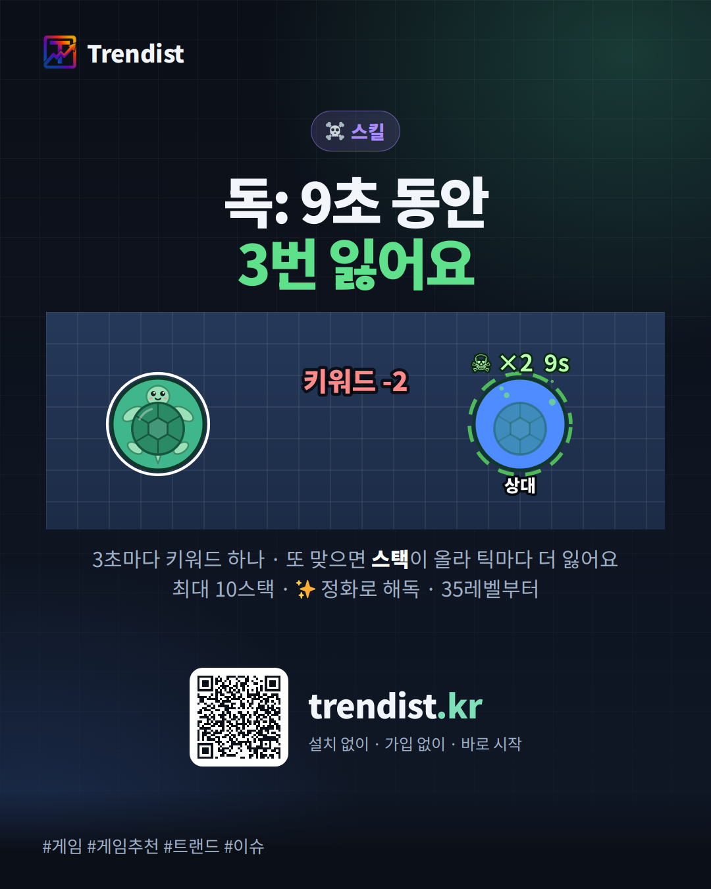

**캡션(복사해서 사용)**
```
독: 9초 동안 3번 잃어요 ☠️

겨눈 방향으로 독을 던져요. 맞으면 9초 동안 3초마다 키워드가 하나씩 빠져요.
끝나기 전에 또 맞으면 스택이 올라서 틱마다 2개, 3개… 최대 10스택.
맞은 사람 머리 위에 ☠ ×스택이 모두에게 보여요.

해독은 ✨ 정화로. 35레벨부터 열려요.

👉 프로필 링크 또는 QR로 바로 시작 (설치 없이 · 가입 없이)

(이모지 그래픽: Twemoji, CC-BY 4.0)
#게임 #게임추천 #트랜드 #이슈 #트렌디스트 #스킬 #독 #pvp
#game #trend #issue #trendist
```

---

## 2026-11-26 · loadout

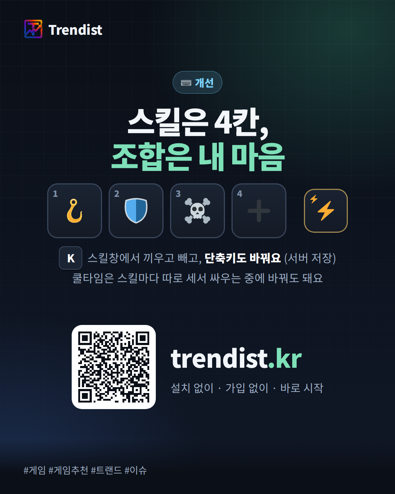

**캡션(복사해서 사용)**
```
스킬은 4칸, 조합은 내 마음 ⌨️

K 키로 스킬창을 열어 4칸에 원하는 스킬을 끼워요. 대시는 장착 없이 늘 써요.
칸마다 단축키도 바꿀 수 있고, 서버에 저장돼서 다른 기기에서도 그대로예요.
쿨타임은 스킬마다 따로 세니까 싸우는 중에 바꿔도 돼요.

공격형(갈고리·충격파·독·암흑)? 생존형(방패·은신·정화·회복)? 댓글로 조합 알려 주세요 👇

👉 프로필 링크 또는 QR로 바로 시작 (설치 없이 · 가입 없이)

(이모지 그래픽: Twemoji, CC-BY 4.0)
#게임 #게임추천 #트랜드 #이슈 #트렌디스트 #스킬 #장착 #빌드 #단축키
#game #trend #issue #trendist
```

---

## 2026-11-27 · dash

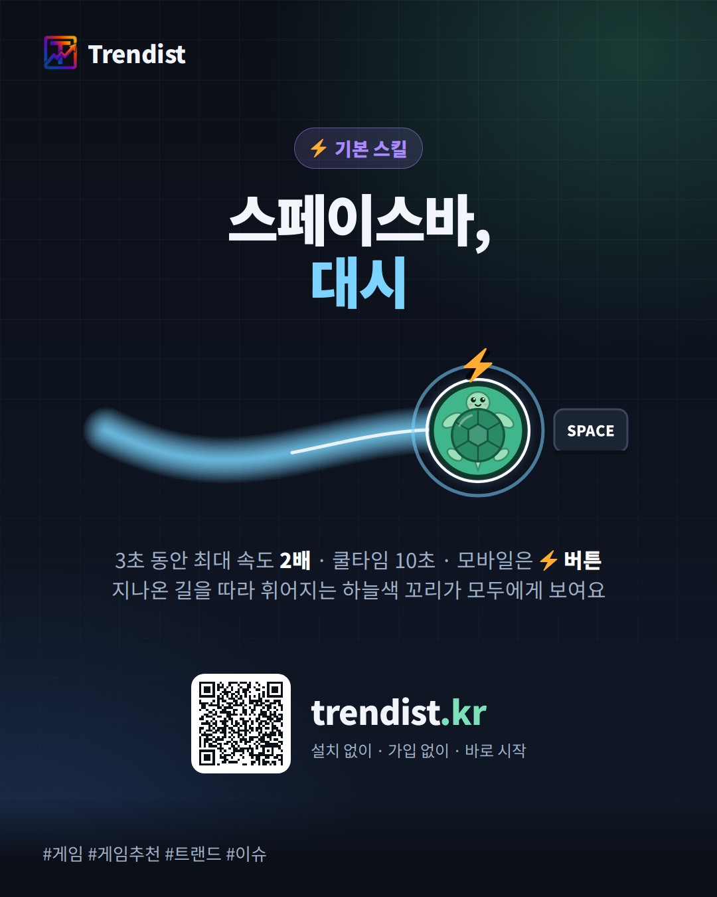

**캡션(복사해서 사용)**
```
스페이스바, 대시 ⚡

3초 동안 최대 속도가 2배가 돼요. 쫓기면 도망, 쫓을 땐 추격.
PC는 스페이스바, 모바일은 스킬 줄 오른쪽의 ⚡ 버튼.
쓰면 하늘색 꼬리가 지나온 길을 따라 휘어져서 모두의 화면에 보여요.

쿨타임은 10초. 움직이는 중에만 써져요.

👉 프로필 링크 또는 QR로 바로 시작 (설치 없이 · 가입 없이)

(이모지 그래픽: Twemoji, CC-BY 4.0)
#게임 #게임추천 #트랜드 #이슈 #트렌디스트 #대시 #조작 #스피드
#game #trend #issue #trendist
```

---

## 2026-11-28 · orbs

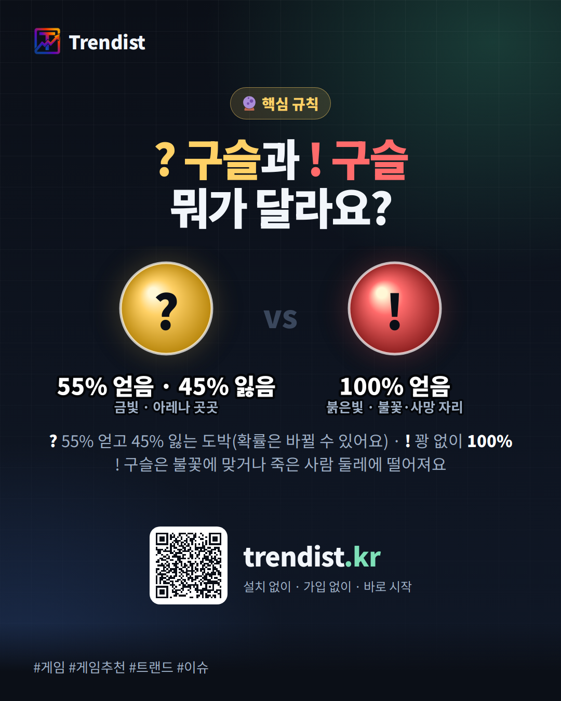

**캡션(복사해서 사용)**
```
? 구슬과 ! 구슬, 뭐가 달라요? 🔮

🟡 ? 구슬: 55%는 🔥 키워드를 얻고, 45%는 가진 키워드 하나를 잃어요. 타이핑 없이 키워드를 얻는 방법이지만 도박이에요. (확률은 바뀔 수 있어요. 지금 값은 게임 가이드에서 확인)
🔴 ! 구슬: 꽝도 잃기도 없이 100% 🔥 키워드. 불꽃에 맞거나 체력이 0이 된 사람 주변에 흩어져요(90초 뒤 사라짐).

붉은 구슬이 보이면 일단 달려가세요. 미니맵에도 붉은 점으로 떠요.

👉 프로필 링크 또는 QR로 바로 시작 (설치 없이 · 가입 없이)

(이모지 그래픽: Twemoji, CC-BY 4.0)
#게임 #게임추천 #트랜드 #이슈 #트렌디스트 #구슬 #확률 #공략
#game #trend #issue #trendist
```

---

## 2026-11-29 · flame

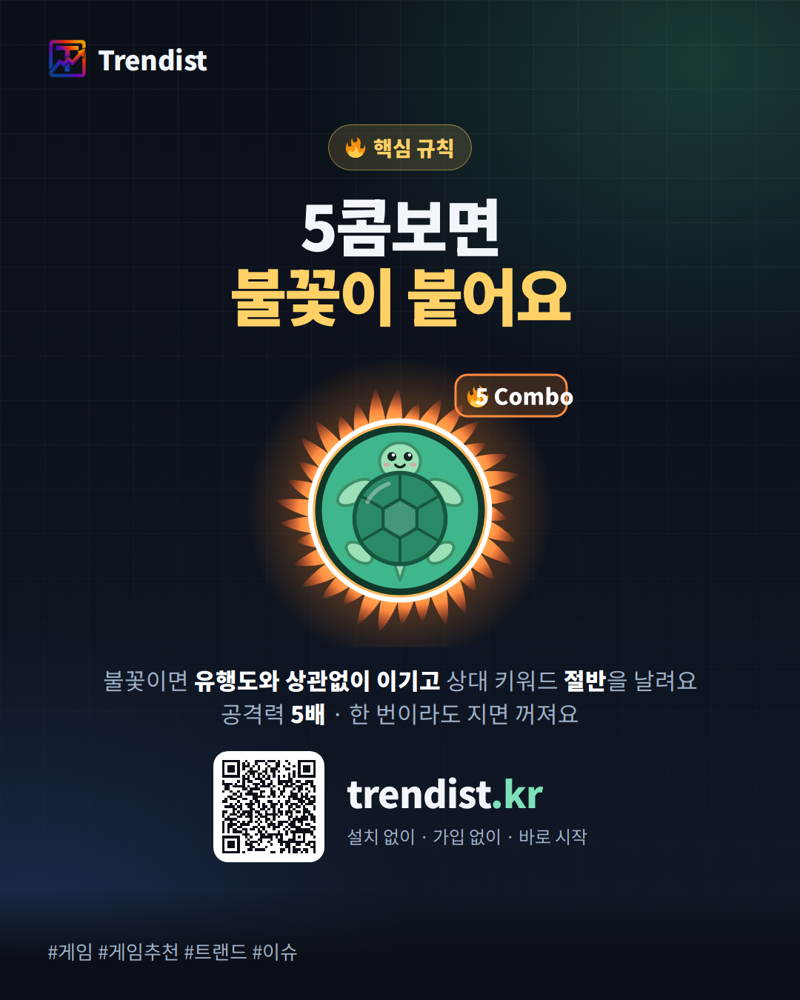

**캡션(복사해서 사용)**
```
5콤보면 불꽃이 붙어요 🔥

키워드를 연속으로 5번 빼앗으면 원 둘레가 불타올라요.
불꽃인 채로 부딪히면 유행도와 상관없이 이기고, 상대 키워드의 절반을 날려요.
불꽃이면 공격력이 5배!

단, 한 번이라도 지면 바로 꺼져요. 5분 동안 콤보가 안 오르면 사라져요.
불타는 사람을 보면? 쫓아가서 꺼 보세요. 그것도 칭호예요 🧯

👉 프로필 링크 또는 QR로 바로 시작 (설치 없이 · 가입 없이)

(이모지 그래픽: Twemoji, CC-BY 4.0)
#게임 #게임추천 #트랜드 #이슈 #트렌디스트 #콤보 #불꽃 #pvp #전략
#game #trend #issue #trendist
```

---

## 2026-11-30 · heal

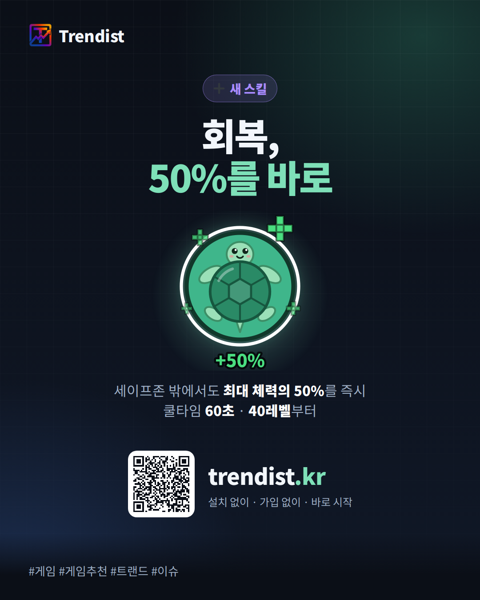

**캡션(복사해서 사용)**
```
새 스킬: 회복 ➕

최대 체력의 50%를 그 자리에서 바로 채워요. 세이프존 밖에서도 OK.
쿨타임 60초, 40레벨부터 쓸 수 있어요.
체력이 이미 가득이면 쓰이지 않고 쿨타임도 안 돌아요.

보스전에서 세이프존까지 돌아갈 시간이 없을 때 꼭 필요해요.

👉 프로필 링크 또는 QR로 바로 시작 (설치 없이 · 가입 없이)

(이모지 그래픽: Twemoji, CC-BY 4.0)
#게임 #게임추천 #트랜드 #이슈 #트렌디스트 #스킬 #회복 #힐 #보스
#game #trend #issue #trendist
```

---

## 2026-12-01 · hp

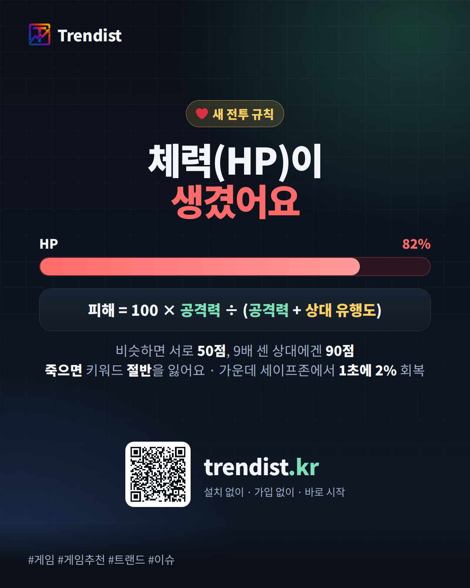

**캡션(복사해서 사용)**
```
체력(HP)이 생겼어요 ❤️

이제 부딪히면 키워드만 잃는 게 아니라 체력도 깎여요.
피해 = 100 × 공격력 ÷ (공격력 + 상대 유행도)
비슷한 상대면 서로 50점씩, 9배 센 상대에겐 90점을 맞아요.

💀 죽으면 가진 키워드의 절반을 잃어요
💙 가운데 세이프존에서 1초에 2%씩 회복
✨ 새 키워드를 얻으면 그만큼 회복

👉 프로필 링크 또는 QR로 바로 시작 (설치 없이 · 가입 없이)

(이모지 그래픽: Twemoji, CC-BY 4.0)
#게임 #게임추천 #트랜드 #이슈 #트렌디스트 #체력 #HP #전투 #업데이트
#game #trend #issue #trendist
```

---

## 2026-12-02 · boss (보스 보상과 한 게시물로)

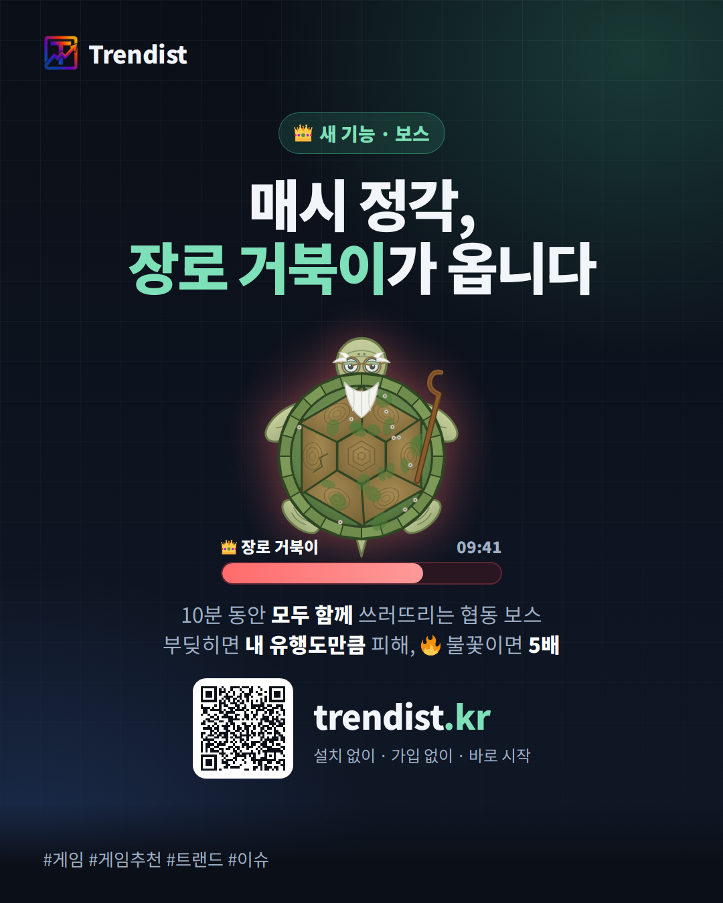

**캡션(복사해서 사용)**
```
매시 정각, 장로 거북이가 옵니다 👑

안경 쓴 거대 거북이가 아레나에 10분 동안 머물러요. 모두 함께 쓰러뜨리는 협동 보스예요.
🐢 부딪히면 내 유행도만큼 피해 (키워드는 안 잃어요)
🔥 불꽃이면 5배! 몇 번 치면 콤보로 불꽃이 붙어요
⚠️ 돌진·충격고리는 피하고, 체력 20% 아래에선 분노해요

쓰러뜨리면 전원에게 보상. 1분 전에 예고가 떠요.

👉 프로필 링크 또는 QR로 바로 시작 (설치 없이 · 가입 없이)

(이모지 그래픽: Twemoji, CC-BY 4.0)
#게임 #게임추천 #트랜드 #이슈 #트렌디스트 #보스 #레이드 #협동 #장로거북이
#game #trend #issue #trendist
```

---

## 2026-12-02 · boss-reward (보스와 한 게시물로)

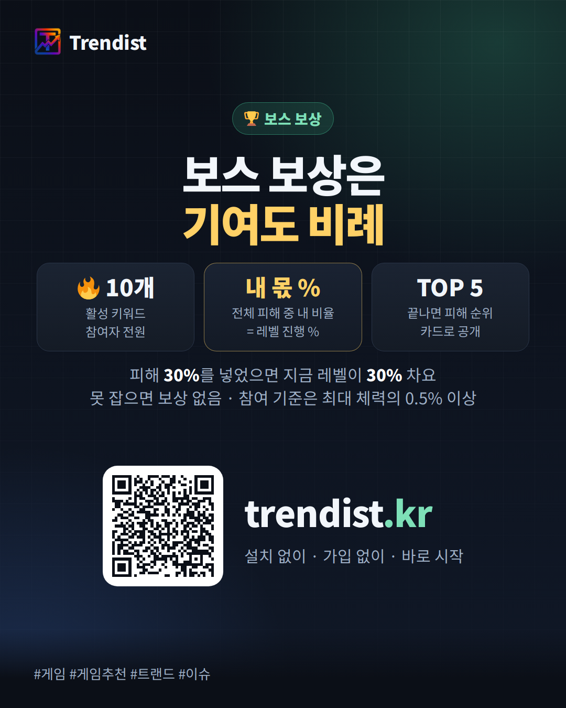

**캡션(복사해서 사용)**
```
보스 보상은 기여도 비례 🏆

보스를 쓰러뜨리면 참여한 모두가
🔥 활성 키워드 10개
📈 전체 피해 중 내 몫만큼 레벨 진행 %
를 받아요. 피해 30%를 넣었으면 지금 레벨의 30%가 한 번에 차요.

시간 안에 못 잡으면 보상은 없어요. 끝나면 피해 TOP 5가 카드로 떠요.

👉 프로필 링크 또는 QR로 바로 시작 (설치 없이 · 가입 없이)

(이모지 그래픽: Twemoji, CC-BY 4.0)
#게임 #게임추천 #트랜드 #이슈 #트렌디스트 #보스보상 #레이드 #기여도
#game #trend #issue #trendist
```

---

## 2026-12-03 · wheel (마지막 게시물)

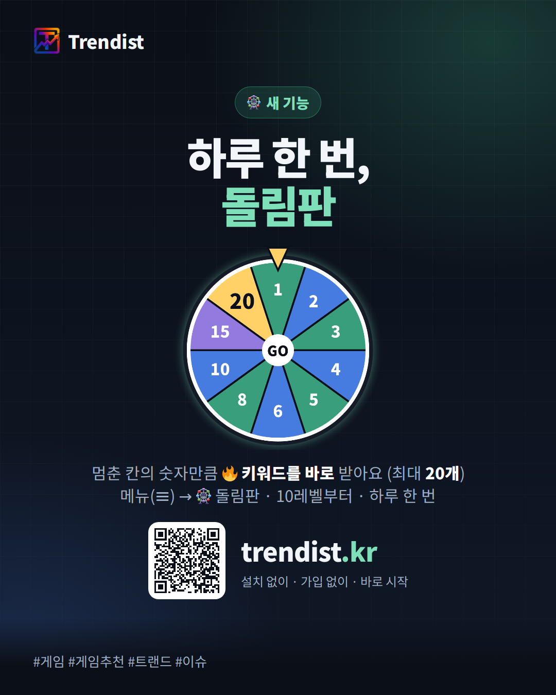

**캡션(복사해서 사용)**
```
하루 한 번, 돌림판 🎡

메뉴(☰)에서 돌림판을 돌리면 멈춘 칸의 숫자만큼 🔥 활성 키워드가 바로 보관함에 들어와요.
칸은 1·2·3·4·5·6·8·10·15·20. 최대 20개!
10레벨부터, 하루에 한 번이에요. 오늘 아직 안 돌렸으면 ☰에 빨간 점이 떠요.

👉 프로필 링크 또는 QR로 바로 시작 (설치 없이 · 가입 없이)

(이모지 그래픽: Twemoji, CC-BY 4.0)
#게임 #게임추천 #트랜드 #이슈 #트렌디스트 #돌림판 #룰렛 #일일보상
#game #trend #issue #trendist
```
